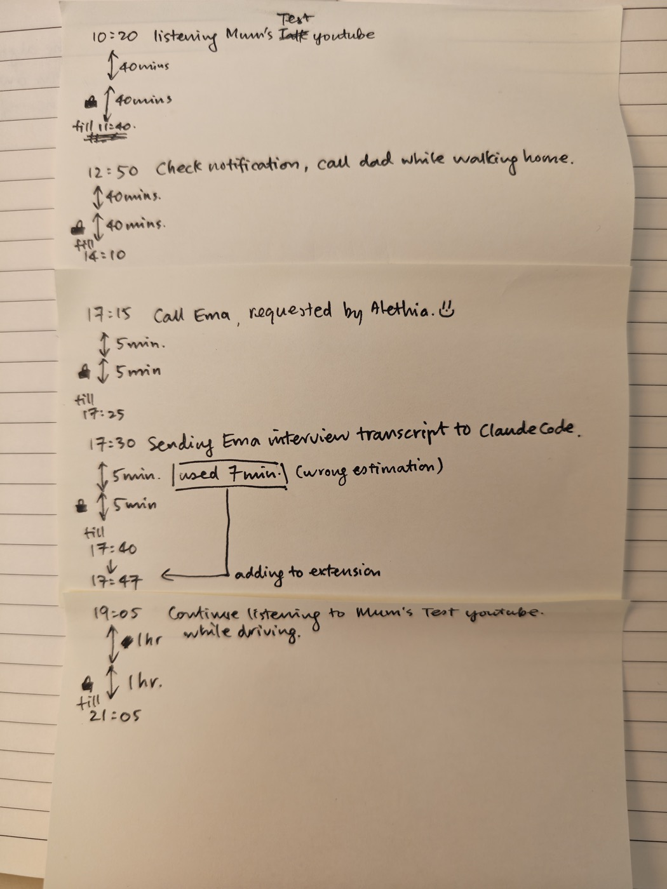

Before I build anything, I want to know whether the actual idea at the centre of this venture works — not on a beta user, not in a survey, but on me, on an ordinary day, with real calls I was expecting and a real deadline sitting on my laptop.

Here's the mechanism, in the words I wrote down for myself a few days before I ran it, because I think it's worth repeating exactly rather than summarising it:

> "Whenever I need to use the phone, I pre-record what I'm going to use it for and for how long, and I voluntarily lock myself into the same interval after the usage. There is currently no more efficient way to actually lock it rather than just put it on flight mode... The essence of this is to help train our mental skill so that we always use the phone how we want to use the phone. If we get distracted somehow, we understand that this is a lesson to be learned, as we were locked into a similar time and couldn't carry out the thing that we meant to do. I believe that this mechanism can be useful to train ourselves, just like one goes to the gym to train their muscles. It's the same concept. It can cause a bit of destruction of your life if you are expecting some calls coming in and you put it on flight mode. As I say, this is just a prototype to see if this mechanism would actually help before we actually build something which is more convenient and makes more sense."

That's the whole idea. Declare what you're about to do and for how long, before you do it. When the time is up, lock yourself out for the same length of time. Right now there's no clever app doing the locking — there's no app at all. The "lock" is flight mode, switched on by my own hand, on the honour system of a page of handwriting.

On the 24th, I actually ran it, for a full day. Five entries.

**10:20** — walking toward the town library, listening to a YouTube reading of a book called *The Mom Test*, timed on my watch. Forty minutes planned. Forty minutes locked afterward. Till 11:40.

**12:50** — checking notifications, then calling my dad while walking home. Forty minutes planned, forty locked, till 14:10.

**17:15** — a five-minute call my daughter Alethia asked me to make. She asked, so I did — a small, nice thing that has nothing to do with the experiment and everything to do with why I'm running it at all. Five minutes planned, five locked, till 17:25.

**17:30** — sending over an interview transcript I'd recorded. Five minutes planned.

**19:05** — the same book again, this time on a last-minute drive to pick up dinner. An hour planned, an hour locked, till 21:05.

The morning is the one I actually want to start with, because it's the version of this that worked better than I expected. I'd set myself a hard rule for the day: no laptop, which I normally carry everywhere, and a genuinely tech-free stretch at the library. I still needed my phone for the walk there, so I set a forty-minute timer on my watch rather than trust myself to check the clock, and kept listening until it went off. The moment it did, I stopped the audio mid-sentence, put the phone into flight mode, took a screenshot for the record, and walked in and opened a physical book. I read for what I think was an hour, maybe two — I genuinely lost track, which is rather the point. My only real distraction was other people talking nearby. I'd committed to forty minutes of lockout; I gave myself several times that, voluntarily, because I was somewhere I couldn't be interrupted and it turned out I liked it there. The log only records the minimum I'd promised myself. It doesn't capture how much further past it I actually went, on the days the thing works.

The walk home had its own small piece of discipline in it, easy to miss. I'd planned forty minutes for notifications and the call to my dad, but I finished both in less than that. Rather than let the unused time turn into idle scrolling, I put the phone straight into flight mode anyway, and held myself to the original end time — 14:10 — rather than starting a fresh clock from whenever I actually stopped. Finishing early doesn't buy you anything extra. It just means the lock starts sooner.

The 17:15 call carries a story worth telling in full, because it wasn't really my entry at all. My daughter Alethia wanted to know if it was a good time to go play with a neighbour's daughter, and I was the only one in the house with a phone. I told her what I was doing with the log and the timer, and she was curious enough about it — she's like that with anything mechanical or rule-based — that she wanted to run her own version of it. She's the one who estimated five minutes, not me. Before she'd even committed the entry to the log, she'd already thought of something I hadn't: she could just walk over and knock, no phone at all. She talked herself out of it on her own — she decided that turning up unannounced might come across as interrupting, and that calling first was the more considerate way to do it. So she logged five minutes, and I told her that with a window that short, a text message is a bad bet, because you can't control when someone reads it — a call gives a much better shot at an answer inside the time you actually have. We called rather than texted. Nobody picked up. She left a message instead: "Can I go over to you now?" The reply came back with maybe a minute to spare. She was thrilled, headed straight out to play, and left me in the house with a phone I'd already committed to keeping dark for five more minutes.

That's worth sitting with for a second, because I don't think it was an accident. The moment you have to stop and declare what you're about to use the phone for, before you're allowed to use it, you've created a small gap — and in that gap, her first instinct wasn't "how do I use the phone for this," it was "do I need the phone for this at all." The friction didn't just shape how she used the phone afterward. It made her consider not using it in the first place. That's a version of the mechanism I hadn't planned for, and possibly the most interesting one.

Four of those five held the boundary cleanly. On their own, they don't tell me much — a system that only ever gets tested when it's convenient isn't really being tested at all.

The one that matters is the fourth. Next to "5 minutes planned," I wrote what actually happened: "used 7min (wrong estimation)." I ran two minutes over my own estimate, sending a transcript.

Here's the part I want to be honest about, because it's the actual finding of the day, and it's more uncomfortable than "the system held me to it" would suggest: nothing held me to it. There's no automatic setup here — no app enforcing anything, nobody watching, nothing that would have noticed if I'd just let it go. The five minutes had a mechanical cause: the transcript wasn't a single copy-paste, it was several sections, switching between apps each time, and that took longer than I'd judged. When the five minutes were up, mid-task, I had a real, live choice — stop, or carry on. I chose to carry on, and I told myself a small story to make that feel fine: I hadn't been distracted, so it barely counted; and if I stopped now, I'd likely have to redo the whole thing from scratch once the lock ended anyway, which felt like a worse use of five more minutes than just finishing. That reasoning isn't wrong, exactly, but I noticed myself reaching for it awfully quickly. I finished the task. It had taken seven minutes, not five. And then I had a second choice, entirely separate from the first, that nothing was forcing either: own the two minutes, or quietly let it go, since I was the only one keeping score. I wrote "used 7min (wrong estimation)" in the log, and added the two minutes onto the lock myself — 17:40 became 17:47, noted as "adding to extension." Nobody made me do either of those things. That's what actually matters about it.

Worth being precise about what kind of mistake this actually was, because it changes what the right response should have been. I wasn't distracted. I hadn't drifted off into something else and lost the thread — I stayed on exactly the task I'd declared, the whole time. This was a pure misjudgment of how long it would take, nothing more. If this had been five minutes of something entertaining that turned out to be a genuinely engaging seven-minute clip, I think the right move is to bite the bullet at five: stop cold, take the lockout, come back later and finish watching. Pausing and resuming a video costs you almost nothing. But a half-sent transcript doesn't work that way — stopping cold at five minutes and picking it up again later would very likely have cost me more than the two minutes I went over, because I'd have been starting the whole task again, not resuming it. So I let it run to seven, and paid for it afterward. The lesson isn't just "hold the boundary." It's more precise than that: know which kind of thing you're doing. Anything you can cleanly pause and pick back up, hold your original estimate. Anything you can't — a task that only counts once it's finished — pad the estimate generously going in. Finishing early costs you nothing; you can always end the lock the moment you're done. Running short costs you the overrun, or the whole task again from the start.

I also have ten screenshots from that day — my phone's Control Center, roughly timed across the same hours, flight mode flicking on and off, the battery draining down through the afternoon, my earbuds and watch dropping in and out as the radios cut. I haven't checked whether they line up minute-for-minute with the page, and I'm not going to claim a precision I don't actually have. But they exist, unedited, and they tell the same rough story the handwriting does: a day genuinely spent switching a phone off and back on, not a story assembled afterward to sound tidier than it was.

I want to be straight about the cost too, because a mechanism only means something if I say what it actually took from me. Flight mode doesn't know the difference between a distracting app and a call I might genuinely be waiting for. It blocks everything, indiscriminately. If someone had needed to reach me urgently during any of those five windows, they couldn't have. That's a real risk, not a hypothetical one, and it's the whole reason I'm calling this a prototype rather than a solution. I'm testing whether the underlying idea — declare it, then live inside the boundary you declared — changes anything in a person at all, before anyone spends real time building something more convenient, like a tool that blocks only the apps I actually named rather than the whole phone.

One more thing worth noting, because it's the same shape as the morning: the evening drive wasn't just the audiobook. It doubled as a supply run — a late decision to get takeaway, half an hour each way to a service station, downloading the restaurant's app on the way for a discount, ordering while I was there. All of it happened inside the hour I'd already declared. When I got home, I put the phone back into flight mode and didn't touch it again — not at 21:05 when the formal lock ended, but for the rest of the night, straight through until the next morning. The log says one hour. The actual number was closer to the whole evening. Nobody was enforcing that part either.

So what did one day teach me? Mostly this: the value wasn't in the four times it worked without incident. It was in the one time it didn't, and in what I chose to do about it when nothing was making me do anything. I could have talked my way out of two minutes — there was nobody to stop me, and I'd already half-written the excuse. I didn't. I held the boundary I'd set for myself, before I had any reason to want it held, entirely because I decided to.

That's a strange, small, slightly uncomfortable feeling — closer to an extra rep at the gym than anything to do with notifications or apps. It isn't really about the phone. It's about whether I can make a promise to myself in advance and have it hold at the exact moment I'd rather it didn't.

That's the actual bet underneath this whole venture: that people don't mainly need to be told to use their phones less. They need a way to practise keeping a promise to themselves about how they use them — and the practising, including the part where you get the estimate wrong, is what actually trains something.

I'm not going to pretend one day proves anything. It doesn't. It's one person, one page, one honest mistake, corrected by a system built entirely out of paper and a flight mode switch. What I want now is for other people to try the same thing on themselves — same rule, same honesty, same handwritten log — and tell me what happens. Especially the parts where it goes wrong, where you're tempted to cheat, or where flight mode costs you a call you actually needed. That's the part I actually want to hear about.
